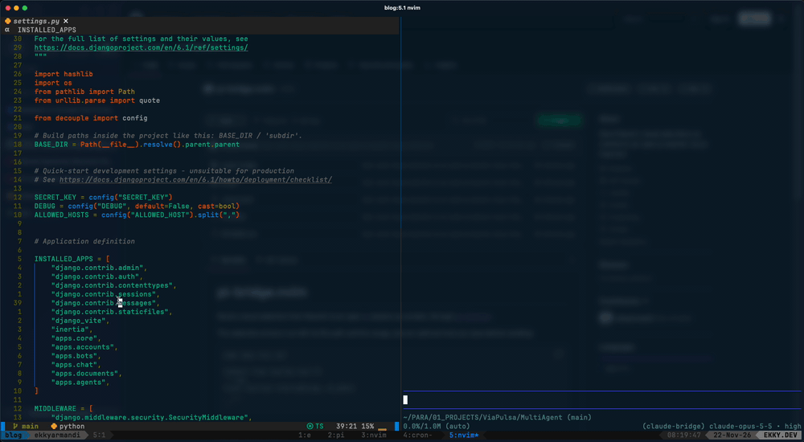

# pi-bridge.nvim

Send a visual selection from Neovim to an open [pi](https://github.com/earendil-works/pi) session as context, through [pi-intercom](https://www.npmjs.com/package/pi-intercom).



The selection arrives in pi with its file path and line range, plus an optional note you type before sending:

````
what does this do?

Context from lua/foo.lua:7-9
```lua
local function intercom(args, on_done)
  ...
```
````

## Requirements

- Neovim 0.11+
- Node.js
- pi with the pi-intercom extension installed, and at least one pi session running in the same working directory as Neovim

## Installation

With [lazy.nvim](https://github.com/folke/lazy.nvim):

```lua
{
  "ekkyarmandi/pi-bridge.nvim",
  cmd = "PiSend",
  keys = {
    { "<Leader>pp", function() require("pi-bridge").send() end, mode = "x", desc = "Pi: send selection" },
  },
  opts = {},
}
```

## Usage

- Select text in visual mode and press your mapping, or run `:PiSend` on a line range (`:PiSend`, `:%PiSend`, `:'<,'>PiSend`).
- Type an optional note and press Enter. Press Esc to cancel.
- The message goes to the pi session whose working directory matches Neovim's `:pwd`. If several match, you pick one.

Each send starts a turn in the receiving pi session, even if it was idle.

## Configuration

Defaults:

```lua
require("pi-bridge").setup {
  -- path to the pi-intercom CLI script
  cli = vim.fn.expand "~/.pi/agent/npm/node_modules/pi-intercom/cli.mjs",
}
```

## License

MIT
